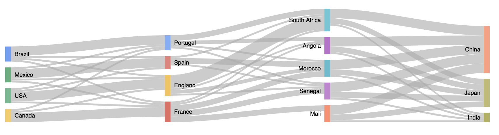
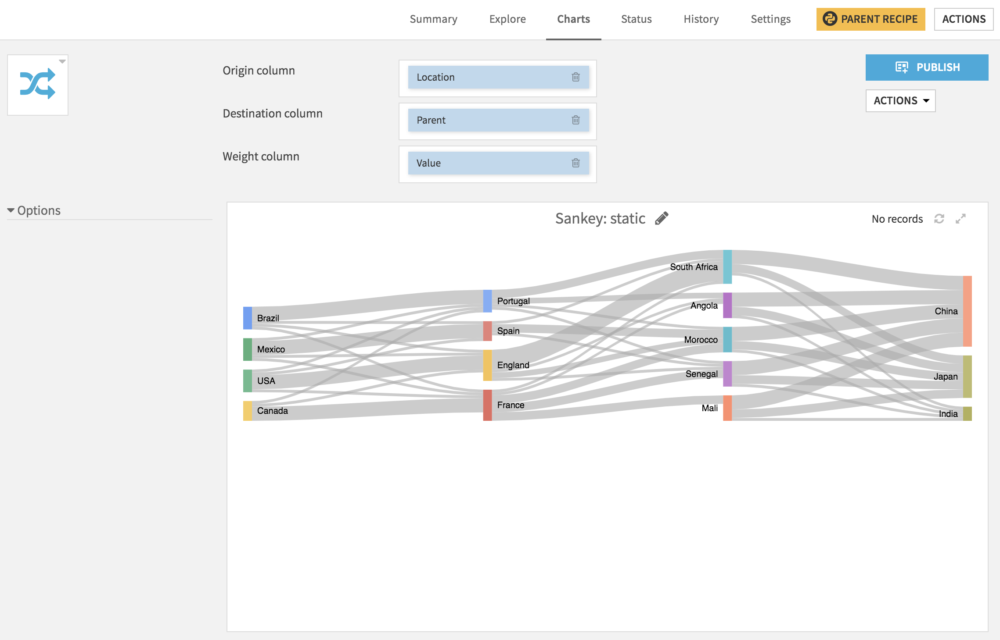
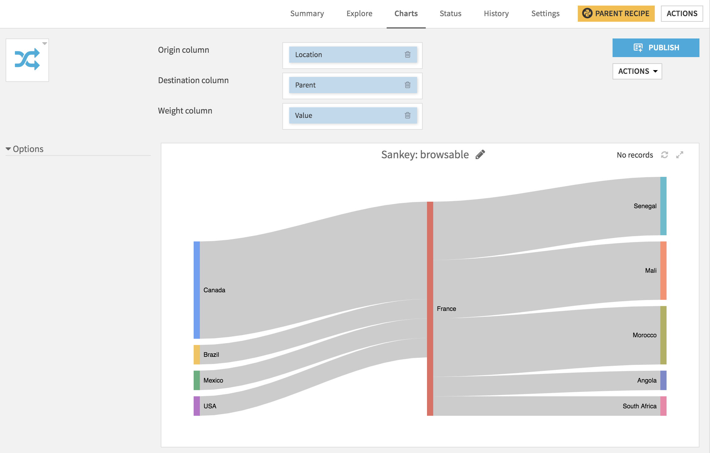

# Flow charts

This Dataiku DSS plugin helps you create, without code, charts to visualize transfers, transitions or other types of flows.

It contains several webapps for different flavors of the Sankey chart.

The charts are based on the [Google Charts library](https://developers.google.com/chart/) and require internet access.

## Description

Sankey charts are used when you want to show a n-to-n mapping between
two entities (e.g., countries and continents) or paths through several
states (customer journey in an e-commerce website). The arrow widths are
proportional to the flow's volume. The entities/states are usually
represented in layers.

## Installation Notes

The plugin can be installed from the Plugin Store or via the zip
download (see above).

*Reminder:* A custom chart is an additional way to visualize information
about a dataset, custom charts appear in the 'other' set of charts on a
dataset.

## Components

### Static Sankey

No processing is done on the data, states are rendered using weighted arrows.

### Browsable Sankey

This Sankey chart focuses the reprentation on a specific state and only renders the predecessors the successors. If a state is both a predecessor and a successor, it is considered as two distinct nodes (no
cycles are possible; they are often not interesting in the case of flow visualization).

In this mode, the sankey chart is browsable: you can click on any predecessor or sucessor and it will re-render the chart with this state as the central node.

This mode is particularly suited for large sankey graphs or cyclic ones.

## License
This project is licensed under the Apache Software License.
